<!-- Perfil GitHub · Rafael Ruscher · as imagens animadas ficam em assets/ -->

  

  
  
  
  
  
  <a href="https://x.com/rruscher">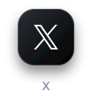</a>
  <a href="https://www.deviantart.com/actionman">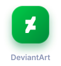</a>
  <a href="https://codepen.io/ruscher">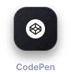</a>

  

## `01` &nbsp;Sobre mim

Sou desenvolvedor **Full Stack**, formado em **Análise de Sistemas**, e trabalho onde código e design se encontram: desenvolvimento de software, análise de dados, segurança da informação e **UX/UI Design**. Gosto de transformar problemas reais em ferramentas simples, rápidas, acessíveis e agradáveis de usar.

Colaboro voluntariamente com o **[BigLinux](https://www.biglinux.com.br/)** desde 2022, criando aplicações, interfaces, ícones e ferramentas de sistema para quem usa Linux no dia a dia, com **KDE Plasma, Qt/QML, GTK4/libadwaita, Python, Rust e Shell Script**. No [YouTube](https://www.youtube.com/@rruscher), faço lives sobre Linux, software livre, programação, hardware e jogos.

> **Minha missão:** deixar o software livre cada vez mais intuitivo, bonito e acessível para todo mundo.

<b>About me in English</b>

 

I'm a **Full Stack Developer and UX/UI designer** with a background in Systems Analysis. Since 2022 I've been a volunteer contributor to **BigLinux**, with 537 merged pull requests across 47 repositories: desktop apps, icon themes, the system installer and the control center. I also stream about Linux and open source for the Brazilian community. My focus: **make open-source software powerful, accessible and enjoyable for everyone.**

## `02` &nbsp;Principais contribuições

Quase todo o meu código público vive no **[BigLinux](https://github.com/biglinux)**, onde ajudo a desenhar e construir o desktop: dos ícones ao instalador.

  

  <a href="https://github.com/biglinux/bigcam"></a>
  <a href="https://github.com/biglinux/big-remote-play"></a>
  <a href="https://github.com/biglinux/bigamemode"></a>
  <a href="https://github.com/biglinux/tts-biglinux"></a>
  <a href="https://github.com/biglinux/biglinux-icons-material"></a>
  <a href="https://github.com/biglinux/bigcontrolcenter"></a>
  
  <a href="https://github.com/ruscher/youtube-cut"></a>

<b>Outras contribuições no BigLinux</b>

 

| Área | Repositórios |
| :--- | :--- |
| Instalação e boot | [calamares-biglinux](https://github.com/biglinux/calamares-biglinux) · [biglinux-calamares-wmaker](https://github.com/biglinux/biglinux-calamares-wmaker) · [grub-btrfs-timeshift](https://github.com/biglinux/grub-btrfs-timeshift) · [biglinux-grub-restore](https://github.com/biglinux/biglinux-grub-restore) · [biglinux-livecd](https://github.com/biglinux/biglinux-livecd) |
| Visual e temas | [biglinux-session-and-themes](https://github.com/biglinux/biglinux-session-and-themes) · [sddm-theme-biglinux](https://github.com/biglinux/sddm-theme-biglinux) · [grub-theme-biglinux](https://github.com/biglinux/grub-theme-biglinux) · [biglinux-base-icons](https://github.com/biglinux/biglinux-base-icons) |
| Sistema e hardware | [biglinux-settings](https://github.com/biglinux/biglinux-settings) · [biglinux-config](https://github.com/biglinux/biglinux-config) · [biglinux-driver-manager](https://github.com/biglinux/biglinux-driver-manager) · [big-screen-monitor-display](https://github.com/biglinux/big-screen-monitor-display) |
| Apps | [big-store](https://github.com/biglinux/big-store) · [biglinux-welcome](https://github.com/biglinux/biglinux-welcome) · [biglinux-noise-reduction-pipewire](https://github.com/biglinux/biglinux-noise-reduction-pipewire) · [bigocrpdf](https://github.com/biglinux/bigocrpdf) |

## `03` &nbsp;Arte & experimentos

Antes do código, veio o design: logos, wallpapers e arte 3D e vetorial no DeviantArt, e protótipos de interface no CodePen.

  <a href="https://www.deviantart.com/actionman"></a>
  <a href="https://codepen.io/ruscher"></a>

## `04` &nbsp;Ferramentas do dia a dia

  

  

e também <b>KDE Plasma · QML · PySide6 · libadwaita · Inkscape · GIMP · Ollama · Whisper · i18n</b>

## `05` &nbsp;Atividade

  

## `06` &nbsp;Vamos colaborar?

Gosto de trocar ideias sobre **Linux, código aberto, experiência do usuário, automação e IA local**. Tem uma ideia, achou um bug ou quer contribuir com o BigLinux? Me chama no [Telegram](https://t.me/rruscher) ou no [LinkedIn](https://www.linkedin.com/in/rafaelruscher/).

<b>Fora do código: o que estou ouvindo</b>

 

 

  
    
  

